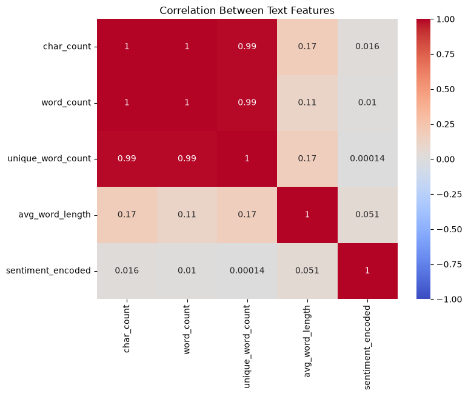
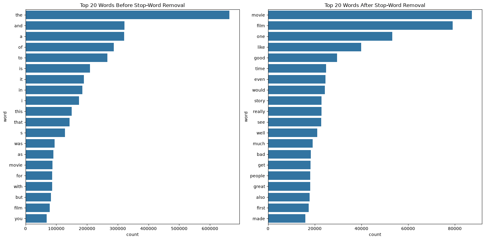
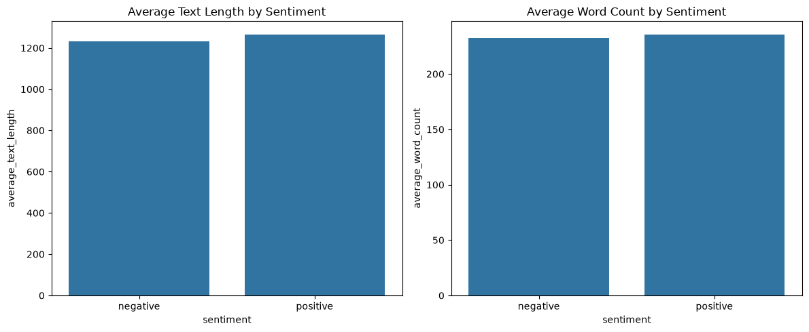
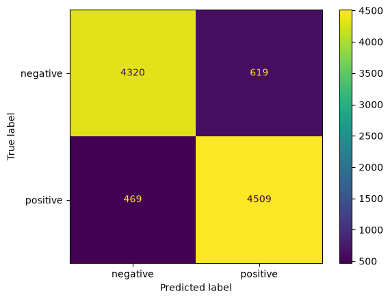
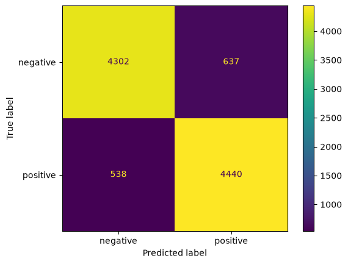

# CSCI461 Assignment 1 — IMDB Review Analysis

Analysis of 50,000 IMDB reviews covering data preprocessing, text analysis, supervised sentiment classification, and K-Means clustering. After removing 418 duplicate rows, the analysis uses 49,582 reviews. The cleaned corpus contains approximately 11.62 million tokens, with an average of 234 words per review. The positive and negative classes are nearly evenly represented.

## Project structure

```text
.
├── data/IMDB Dataset.csv
├── notebook/analysis.ipynb
├── output/
│   ├── figures/
│   └── files/
├── screenshots/
├── Dockerfile
└── requirements.txt
```

`output/figures/` contains the generated plots. `output/files/` contains the cleaned dataset, model metrics, and clustering summary. `screenshots/` contains the Docker and JupyterLab evidence.

## Run with Docker

Run these commands from the project root in PowerShell:

```powershell
docker build -t bd-a1 .
docker run -p 8888:8888 --name bd-a1 -v "${PWD}\notebook:/home/jovyan/work/notebook" -v "${PWD}\output:/home/jovyan/work/output" bd-a1
```

Open the JupyterLab URL printed in the terminal and run `notebook/analysis.ipynb` from top to bottom. The notebook and output folders are mounted from the host, so changes and generated files remain in the project after the container stops.

The Dockerfile copies the dataset into the image and installs the packages listed in `requirements.txt`.

## Results

| Model | Test accuracy |
|---|---:|
| Logistic Regression | 89.03% |
| LinearSVC | 88.15% |

Logistic Regression achieved slightly higher test accuracy. LinearSVC had a larger gap between training accuracy (95.70%) and test accuracy (88.15%), indicating greater overfitting.

The final K-Means model uses four clusters and has a silhouette score of **0.0243**, indicating weak cluster separation. Cluster 0 is nearly balanced, clusters 1 and 2 lean positive, and cluster 3 is predominantly negative. These are loose groupings rather than cleanly separated sentiment categories.

## Figures

**Correlation heatmap**



**Word-frequency comparison**



**Review-group comparison**



**Logistic Regression confusion matrix**



**LinearSVC confusion matrix**



## Assignment coverage

| Requirement | Location |
|---|---|
| Dataset inspection, cleaning, sampling, transformations, and correlation | `analysis.ipynb` — Data Analysis and Preprocessing |
| Text cleaning, token statistics, word frequencies, group comparison, and observations | `analysis.ipynb` — Text Analysis |
| TF-IDF, Logistic Regression, LinearSVC, evaluation, and confusion matrices | `analysis.ipynb` — Supervised Text Classification |
| K-Means, cluster evaluation, cluster sizes, and label comparison | `analysis.ipynb` — K-Means Clustering; `output/files/cluster_summary.txt` |
| Docker image, container, JupyterLab, and Docker Hub evidence | `Dockerfile` and `screenshots/` |

## Docker Hub

Published image: `lark201/bd-a1:latest`

```powershell
docker pull lark201/bd-a1:latest
docker run -p 8888:8888 --name bd-a1 -v "${PWD}\notebook:/home/jovyan/work/notebook" -v "${PWD}\output:/home/jovyan/work/output" lark201/bd-a1:latest
```

To publish an updated image:

```powershell
docker tag bd-a1 lark201/bd-a1:latest
docker push lark201/bd-a1:latest
```
